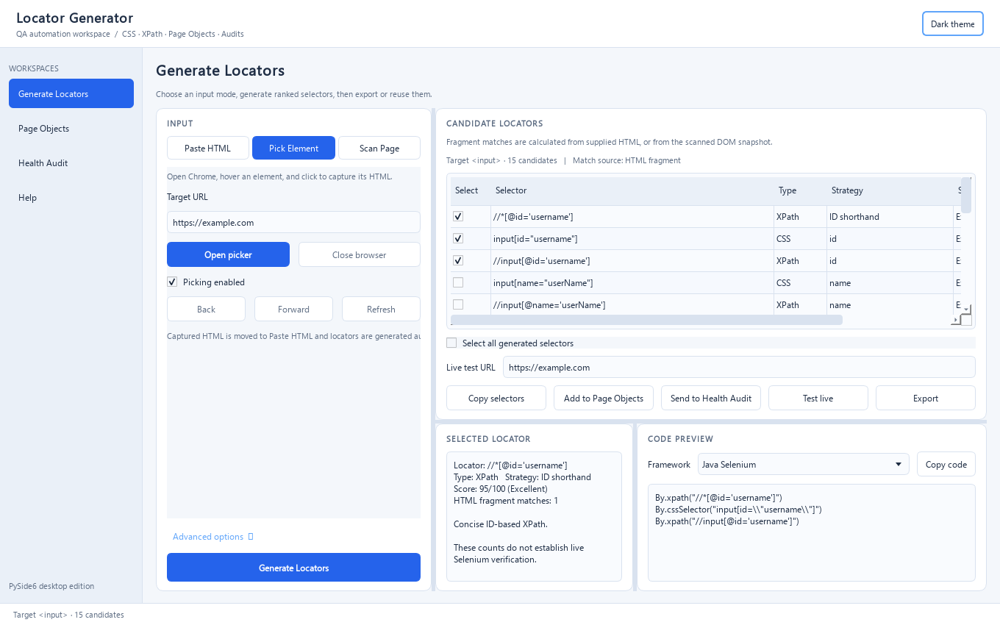

# Locator Generator

Locator Generator is a Windows desktop tool for creating, selecting, checking, and exporting CSS and XPath selectors for web UI automation. It brings an embedded element picker, ranked locator suggestions, framework code previews, Page Object Model support, and live locator audits into one workspace.

## Screenshots

### Element Picker and locator selection



### Locator generation and candidate review


### Page Objects


### Health Audit


### Built-in guide


## Main features

- Capture elements in the embedded browser, paste HTML, or scan a page.
- Generate ranked CSS and XPath locator candidates and select individual results or all results.
- Exclude chosen locator patterns and preview bindings for supported automation frameworks.
- Review a captured element’s locator bundle, details, and generated code.
- Copy selectors, test them live, send them to Health Audit, add them to Page Objects, or export CSV/XLSX.
- Create Page Object classes with a custom variable name for each locator.
- Validate locators against a live page and inspect suggested alternatives. Snapshot-derived alternatives remain suggestions until tested live.
- Adjust the workspace for different window sizes and use the zoom controls.

## Download the standalone Windows app

[Download the latest Windows build](https://media.githubusercontent.com/media/Michael70magdy/Locator-Generator/main/latest%20build/locator_generator_pyside6.exe?download=1) from `latest build/locator_generator_pyside6.exe`.

The bundled executable includes Python and the app’s runtime dependencies; a separate Python or PySide6 installation is not required. It is built for 64-bit Windows. Live browser validation and Selenium-based workflows require a supported browser such as Chrome or Edge; Selenium Manager may need an internet connection to obtain a matching driver.

## Run from source

Requirements: Windows, Python 3.10+, and PySide6. Selenium is needed for Selenium-based live browser workflows.

```powershell
py -m pip install PySide6 selenium
py locator_generator_pyside6.py
```

You can also double-click `run_locator_generator.bat`.

## Typical workflow

1. Open **Element Picker**, navigate to a page or paste an HTML element.
2. Capture or scan the elements you need.
3. Select one or more captured bundles and review their candidates and code preview.
4. Choose a framework and adjust ignored locator patterns if needed.
5. Copy selectors, test live, send selections to Health Audit, add them to Page Objects, or export.
6. In Page Objects, give each locator a meaningful variable name and generate the class.

## Project files

| File | Description |
| --- | --- |
| `latest build/locator_generator_pyside6.exe` | Current standalone 64-bit Windows build |
| `locator_generator_pyside6.py` | Current PySide6 app source |
| `locator_generator.py` | Older Tkinter implementation retained as a reference |
| `run_locator_generator.bat` | Windows source launcher |
| `Locator_Generator_Overview.pptx` | Current app overview presentation |
| `Locator_Generator_Showcase.pptx` | Earlier presentation retained for reference |
| `screenshots/` | App screenshots used in this README and overview deck |

## Notes

Locator score and stability labels are heuristics. Always confirm selectors in the target application and your own automation environment. Health Audit results describe the page state tested; fallback alternatives derived from a snapshot are not live-validated unless explicitly tested.

## Feedback

When reporting a bug, include your Windows version, whether you used the EXE or source, the steps to reproduce it, and any error message.

