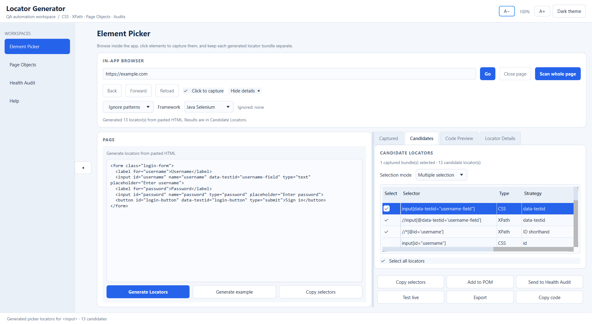
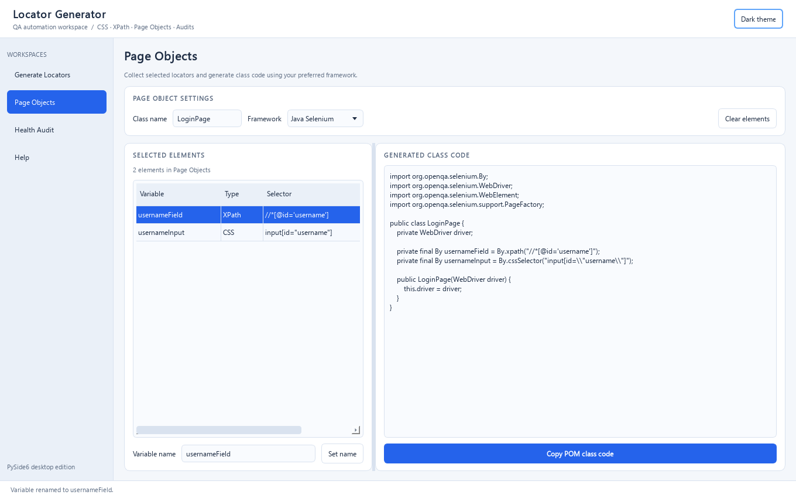
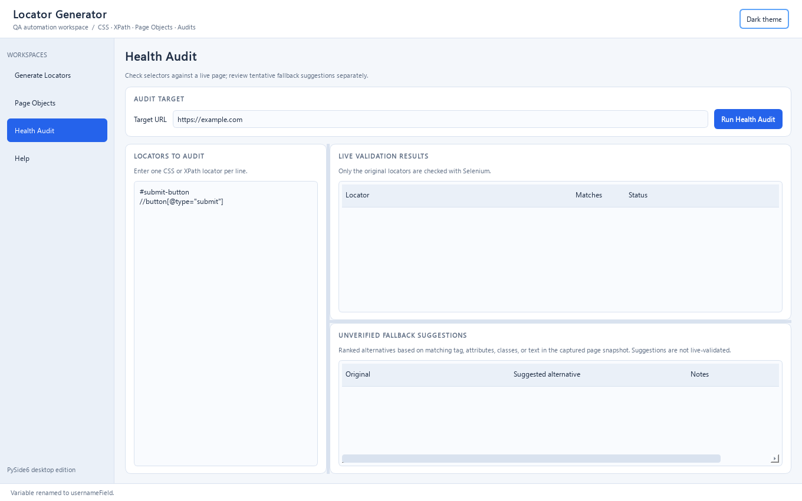
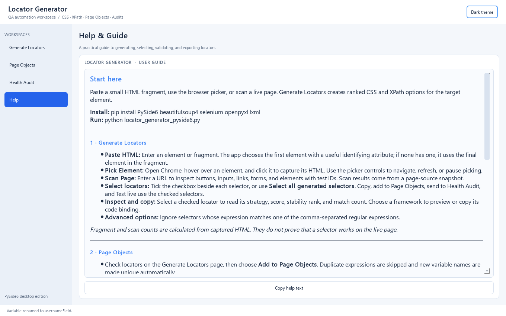

# Locator Generator

A desktop tool for creating, reviewing, organizing, and exporting CSS and XPath selectors for web UI automation. The current application is the PySide6 version in `locator_generator_pyside6.py`.

> `locator_generator.py` is the older Tkinter implementation and is retained as a legacy reference. Run `run_locator_generator.bat` to launch the current PySide6 application.

## Screenshots

### Locator generation and selector selection



### Page Object Model builder



### Locator health audit



### In-app help guide



## Features

- Generate ranked CSS and XPath candidates from an HTML fragment or a live page.
- Review each candidate's selector type, strategy, stability rank, score, match count, and notes.
- Select individual locators with checkboxes or select all generated elements.
- Pick elements from a browser page and scan a page when Selenium is installed and configured.
- Preview code bindings for supported automation frameworks using the framework dropdown.
- Build Page Object Model classes from selected locators, with a custom variable name for each element.
- Audit locator validation and review ranked, unverified fallback suggestions based on the captured page snapshot.
- Export locator data to CSV and Excel (XLSX).
- Use the built-in guide for feature descriptions and workflow help.

## Requirements

- Windows
- Python 3.10 or later
- PySide6
- Optional: Selenium and a compatible browser/driver for live page features

## Standalone Windows executable

Download [Locator Generator.exe](https://github.com/Michael70magdy/Locator-Generator/raw/refs/heads/main/Locator%20Generator.exe) and double-click it on 64-bit Windows. It bundles Python and the app's required Python packages, so a separate Python or PySide6 installation is not needed. Google Chrome is still required for browser picking, live page scans, and Health Audit.

## Install

```powershell
py -m pip install PySide6
```

For live browser features:

```powershell
py -m pip install selenium
```

Clone or download this repository, then run from its folder:

```powershell
py locator_generator_pyside6.py
```

You can also double-click `run_locator_generator.bat` on Windows.

## Typical workflow

1. Paste an HTML snippet or connect to a page with the live browser tools.
2. Generate locators and inspect the ranking and match information.
3. Check the selectors to keep, or use **Select all generated selectors**.
4. Choose a framework to preview code bindings.
5. Send selected locators to **Page Objects**, set meaningful variable names, then generate or copy the class.
6. Use **Health Audit** to validate selectors against the page and consider any suggested alternatives.
7. Export the reviewed results as CSV or XLSX.

## Important notes

Locator scores and stability labels are heuristic guidance, not guarantees. Fallback suggestions are based on the captured page snapshot and are not automatically live-validated. Selenium workflows depend on a working browser and driver. Always validate generated selectors and code in your own test environment.

## Files

| File | Description |
| --- | --- |
| `locator_generator_pyside6.py` | Current PySide6 application |
| `Locator Generator.exe` | Standalone Windows application |
| `locator_generator.py` | Older Tkinter implementation kept as a reference |
| `run_locator_generator.bat` | Windows launcher |
| `Locator_Generator_Showcase.pptx` | Existing presentation |
| `Locator_Generator_Overview.pptx` | App overview presentation |
| `screenshots/` | Current application screenshots used in this README |

## Feedback

When reporting a bug, include your Python version, the steps to reproduce it, and any error message.
